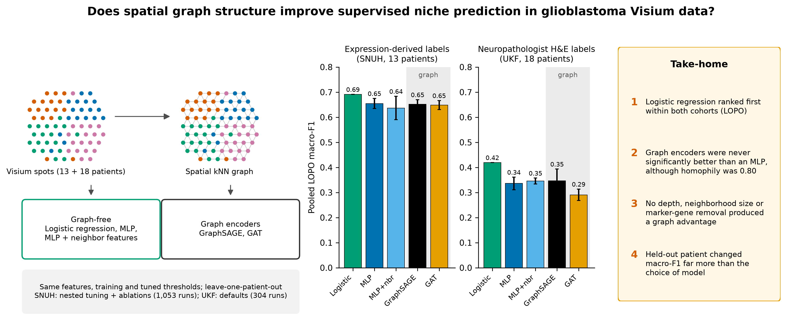

# DeepGraph-GBM

**A patient-level benchmark asking whether spatial graph structure improves supervised niche
prediction in glioblastoma Visium data. It does not.**

[](https://www.python.org/)
[](https://pytorch.org/)
[](https://pyg.org/)
[](LICENSE)



---

## What this is

Visium spots are physically adjacent, so graph neural networks are a natural choice for
predicting spatial niches, and many spatial methods assume the neighbourhood helps. This
repository tests that assumption directly: GraphSAGE and graph-attention encoders against a
multilayer perceptron, an MLP given neighbour-averaged expression, and multinomial logistic
regression — same features, same splits, same optimiser, same decision rule, same tuning budget.

**The graph does not help.** With an equal nested hyperparameter search and leave-one-patient-out
evaluation over 13 patients, logistic regression on per-spot expression has the highest pooled
macro-F1 and no graph model exceeds the best graph-free model. The result holds against
neuropathologist H&E annotations in an independent cohort, and survives ablations of graph depth
and neighbourhood size, exact-hexagonal graph geometry, and removal of the most label-associated
genes — even though the labels are strongly spatially clustered (edge homophily 0.80).

## Headline results

**Primary analysis — leave-one-patient-out, equal tuning budget (13 patients, 3 seeds, 715 runs):**

| Model | Pooled macro-F1 | Δ vs GraphSAGE (95% CI) |
|---|---|---|
| **Logistic regression** | **0.691** | **+0.039 (0.009, 0.076)** |
| MLP | 0.655 ± 0.020 | +0.003 (−0.045, 0.052) |
| GraphSAGE | 0.652 ± 0.018 | — |
| GAT | 0.649 ± 0.018 | −0.004 (−0.032, 0.018) |
| MLP + neighbours | 0.637 ± 0.047 | −0.015 (−0.065, 0.040) |

Confidence intervals are patient-level bootstraps; only the logistic interval excludes zero.

- **Against pathologist labels** (UKF, 18 patients): logistic regression first within the cohort
  (0.419 vs 0.346 for GraphSAGE, p = 0.13). After transfer from SNUH, GraphSAGE leads
  (0.395 vs 0.380, p = 0.25) — the one setting where a graph model is ahead, by a margin that is
  not significant and that depends on input scaling.
- **The held-out patient matters more than the model**: per-patient macro-F1 spans 0.03–0.72 for
  every model, and across-split variance is 3.5–8.1× the within-split seed variance.
- **The decision rule is not neutral**: tuned per-class thresholds raise the graph models by
  0.019–0.034 macro-F1 and lower the per-spot models, so the protocol used throughout is the
  conservative choice with respect to this conclusion.
- **Negative results reported as such**: niche predictions do not transfer to an external cohort,
  and a niche-signature score does not stratify TCGA-GBM survival (HR 1.12 per SD; effects below
  about 1.28 per SD were not detectable at this event count).

> **Retracted claim.** Earlier versions of this repository reported that identical scoring
> *reverses* the model ranking ("the protocol-reversal phenomenon"). That analysis used a
> superseded feature set, was withdrawn in manuscript v5, and the corresponding section, figure
> and table were removed in v6. See `preprint/ANALYSIS_AUDIT.md`.

## Verification status

| | |
|---|---|
| Unit tests | 18/18 pass (`PYTHONPATH=src pytest -q tests`) |
| Independent re-derivation of published values | 99/99 agree (`scripts/29_code_audit_checks.py`) |
| Manuscript numbers against source files | 35/35 (`scripts/28_verify_manuscript_numbers.py`) |
| Label rules vs stored labels | reproduce exactly |
| Test-label leakage | none; no run has its held-out patient in train or validation |

Audit reports: [`preprint/CODE_AUDIT.md`](preprint/CODE_AUDIT.md),
[`preprint/ANALYSIS_AUDIT.md`](preprint/ANALYSIS_AUDIT.md),
[`preprint/PEER_REVIEW.md`](preprint/PEER_REVIEW.md).

## Quickstart

```bash
git clone https://github.com/hossainlab/deepgraph-gbm && cd deepgraph-gbm
python -m venv .venv && .venv/bin/pip install -e ".[dev]"
PYTHONPATH=src .venv/bin/pytest -q tests          # 18 tests, no data needed

bash scripts/01_download_data.sh                  # public datasets (~11 GB)
.venv/bin/python scripts/02_build_graphs.py       # per-section PyG graphs
```

The full pipeline, step by step, is in [`docs/WORKFLOW.md`](docs/WORKFLOW.md). To re-derive the
published numbers without retraining anything, run `scripts/28` and `scripts/29`; both read the
records in `results/` (see [`results/README.md`](results/README.md)).

## Datasets

| Cohort | Use | Source |
|---|---|---|
| SNUH GBM spatial atlas | training and the primary benchmark (28 sections, 13 patients, 100,488 spots) | UCSC Cell Browser, `multiomic-gbm` |
| Freiburg (UKF) Visium | neuropathologist H&E labels (23 sections, 18 patients) | Dryad `10.5061/dryad.h70rxwdmj`; annotations per Ritter et al. |
| Greenwald et al. 2024 | external cohort (13 samples, 25,488 spots) | Zenodo `10.5281/zenodo.12624108` |
| TCGA-GBM | bulk survival validation (166 samples, 132 events) | NCI Genomic Data Commons |

The per-spot pathologist annotations used here are released as
`results/tables/supplement/TableS9_ukf_pathologist_annotations.csv`.

## Repository layout

```
deepgraph-gbm/
├── assets/                  # graphical abstract and documentation images
├── configs/                 # model config, label rules, patient splits
├── data/                    # raw and preprocessed datasets (not tracked; see Datasets)
├── docs/                    # WORKFLOW.md (step-by-step pipeline) and topic notes
├── notebooks/               # exploratory notebooks (01-06)
├── preprint/                # manuscript, figures, audit reports, revision history
├── results/                 # tables, per-run metric records, trained weights
├── scripts/                 # numbered pipeline, 01 to 29
├── src/deepgraph_gbm/       # library: data, models, training, interpret
└── tests/                   # pytest suite (labels, graphs, model shapes, splits)
```

## Limitations

- **Silver-standard labels.** SNUH niche labels are rule-derived from the atlas's own anatomical
  and metaprogram annotations. The pathologist-annotated UKF cohort is the independent check.
- **Cohort size.** Thirteen and eighteen patients limit power; several differences between neural
  models are not significant.
- **Six-split threshold protocol.** Four of its six threshold-tuning blocks contain fewer than 20
  immune-hot spots, so that analysis is used for variance decomposition only, not for ranking.
- **Scope.** Two message-passing encoders at Visium resolution. Heterophily-aware designs,
  image or copy-number features, and higher-resolution platforms may behave differently.

## Citation

Hossain MJ. *Spatial graph structure does not improve supervised niche prediction in
glioblastoma.* Preprint, 2026. See [`CITATION.cff`](CITATION.cff).

## License

MIT — see [LICENSE](LICENSE). The author declares no competing interests and received no
specific funding for this work.
