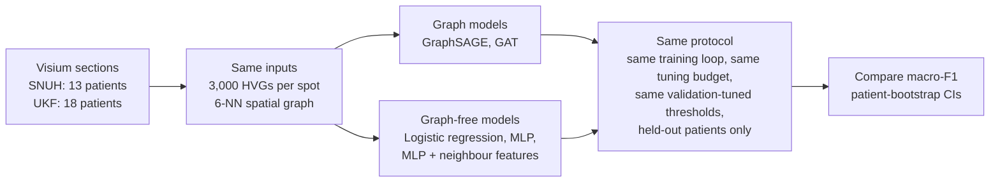

# Chapter 0: Overview — what this project asks, and what it found

## 1. The question in one sentence

**Does giving a model the spatial neighbourhood of each Visium spot improve supervised prediction
of glioblastoma niches, compared with an equally tuned model that sees each spot on its own?**

The answer from this repository is **no**. Under matched training, matched scoring and
leave-one-patient-out evaluation, logistic regression on per-spot expression ranks first, and the
two graph neural networks (GraphSAGE and GAT) are at best level with a plain multilayer perceptron.

---

## 2. Why the question matters

Glioblastoma (GBM), IDH-wildtype, is the most common malignant primary brain tumour in adults,
with median survival of about 15 months despite surgery, radiotherapy and temozolomide
([Stupp et al., *NEJM* 2005](https://doi.org/10.1056/NEJMoa043330)). A single tumour contains
malignant cells in several plastic states ([Neftel et al., *Cell* 2019](https://doi.org/10.1016/j.cell.2019.06.024)),
and these states are spatially organised into recurring niches shaped by hypoxia, necrosis and
immune infiltration ([Greenwald et al., *Cell* 2024](https://doi.org/10.1016/j.cell.2024.03.029)).

Spatial transcriptomics (10x Visium; [Ståhl et al., *Science* 2016](https://doi.org/10.1126/science.aaf2403))
measures gene expression at thousands of spots on a tissue section, each with a physical position.
Because neighbouring spots are physically adjacent, it is natural to treat a section as a graph
and to use graph neural networks (GNNs), which update each spot from its neighbours. Many spatial
methods are built on that assumption: SpaGCN, STAGATE, GraphST, and, for brain-tumour histology,
NePSTA, which reported 87% accuracy against neuropathological segmentation
([Ritter et al., *Nat Cancer* 2025](https://doi.org/10.1038/s43018-024-00904-z)).

What is rarely done is to train the **same model without the graph**, under the same protocol,
and compare. Without that control, nobody knows how much of a reported accuracy comes from the
graph. In graph machine learning more broadly, simple models often match GNNs once data splits
and tuning are controlled ([Shchur et al. 2018](https://arxiv.org/abs/1811.05868);
[Errica et al., *ICLR* 2020](https://arxiv.org/abs/1912.09893)). This project runs that
control for GBM Visium data.

---

## 3. How the question is tested

The design has five layers, each closing a loophole the previous one left open:

| Layer | What it controls | Where |
|---|---|---|
| Matched comparison on one patient split | Same features, optimiser, early stopping and decision rule for every model | [Ch. 5 §1](05_benchmark_results.md) |
| Six repeated patient splits | How much the result depends on which patients are held out | [Ch. 5 §2](05_benchmark_results.md) |
| **Leave-one-patient-out (LOPO), equal tuning budget — the primary analysis** | Every model family gets the same nested hyperparameter search in each of 13 folds | [Ch. 5 §3](05_benchmark_results.md) |
| Ablations, exact-hex graphs, marker-gene removal, homophily | Whether some graph depth, neighbourhood or label property would rescue the graph | [Ch. 5 §4](05_benchmark_results.md) |
| Neuropathologist H&E labels (UKF cohort) | Whether the result is an artefact of labels derived from the same expression the models see | [Ch. 6 §1](06_pathologist_external_survival.md) |

Two further analyses, an external cohort (Greenwald) and a TCGA survival test, are reported as the
negative results they are ([Ch. 6](06_pathologist_external_survival.md)).

---

## 4. What was found

| Model (LOPO, 13 patients, 3 seeds) | Pooled macro-F1 | Δ vs GraphSAGE (95% CI) |
|---|---|---|
| **Logistic regression** | **0.691** | **+0.039 (0.009, 0.076)** |
| MLP | 0.655 ± 0.020 | +0.003 (−0.045, 0.052) |
| GraphSAGE | 0.652 ± 0.018 | — |
| GAT | 0.649 ± 0.018 | −0.004 (−0.032, 0.018) |
| MLP + neighbours | 0.637 ± 0.047 | −0.015 (−0.065, 0.040) |

- Only the logistic-regression interval excludes zero.
- The result is not explained by heterophily: labels are strongly spatially clustered
  (edge homophily 0.80).
- No graph depth, neighbourhood size or exact hexagonal geometry gave the graph an advantage.
  Removing the most label-associated genes did not help it either.
- Against pathologist labels, logistic regression is first within the UKF cohort (0.419 vs 0.346).
  After SNUH → UKF transfer, GraphSAGE leads (0.395 vs 0.380 for the MLP). This is the one setting
  where a graph model is ahead, and the lead is not significant (p = 0.25).
- The held-out patient matters far more than the model: per-patient macro-F1 spans 0.03–0.72 for
  every model.

The paper's recommendation for spatial deep-learning papers:
1. tuned graph-free baselines, including a regularised linear model;
2. identical decision rules for every model;
3. patient-level cross-validation;
4. where possible, labels that are independent of the input expression.

---

## 5. How the project got here (read this if older material confused you)

The repository started in August 2026 as **"DeepGraph-GBM", a multi-task GNN** proposed as a
method. It had three heads: spot niche, mesenchymal (MES) state, and slide-level survival risk.
The matched baselines added during revision showed that graph-free models did as well or better,
so the project was reframed as the benchmark described above. In order:

| Version | Change |
|---|---|
| v1–v3 | GNN presented as the method; baselines added; fixed-split result showed the MLP ahead |
| v4 | Leave-one-patient-out benchmark with equal tuning, ablations, data-driven graphical abstract |
| v5 | Scientific audit ([`preprint/ANALYSIS_AUDIT.md`](../preprint/ANALYSIS_AUDIT.md)): **"protocol reversal" claim retracted**, external and transfer normalisation fixed, exact-hex sensitivity added |
| v6 | Retracted material removed from the manuscript |
| v7–v7.1 | Response to independent review; code audit; six-split benchmark demoted to variance decomposition only |
| v7.2 | Repository cleanup: docs rewritten to the benchmark framing, superseded material moved to `archive/` folders |

The multi-task architecture still exists in `src/` because the fixed-split models (Figures 1–3,
Table 1) were trained with it. It is the **object being tested**, not the contribution. The
slide-level risk head does not recover its own target on held-out sections, and no result
depends on it.

If you meet any of these, they belong to the old framing and are not current claims:
- "protocol reversal"
- "the GNN outperforms"
- an MES correlation of r = 0.30
- "23 sections / ~35,000 spots"

---

## 6. Reading order

1. [Chapter 1](01_biology_and_spatial_data.md): GBM niches, Visium, the four cohorts, the label rules
2. [Chapter 2](02_graph_construction.md): spatial graphs, the array-index caveat, homophily, patient splits
3. [Chapter 3](03_models_compared.md): the five models and how they are trained
4. [Chapter 4](04_evaluation_protocol.md): the evaluation protocol (splits, LOPO, tuning, decision rule, statistics)
5. [Chapter 5](05_benchmark_results.md): benchmark results on the SNUH cohort
6. [Chapter 6](06_pathologist_external_survival.md): pathologist labels, external cohort, survival
7. [Chapter 7](07_references_and_citations.md): references
8. [WORKFLOW.md](WORKFLOW.md): how to reproduce everything, script by script
