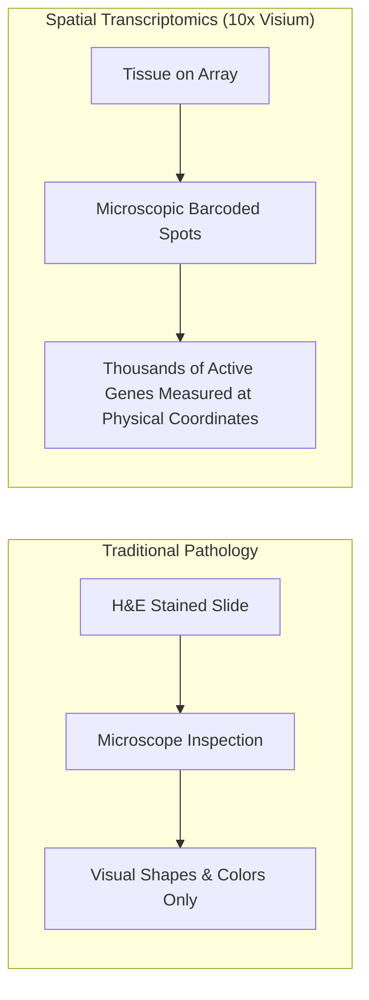
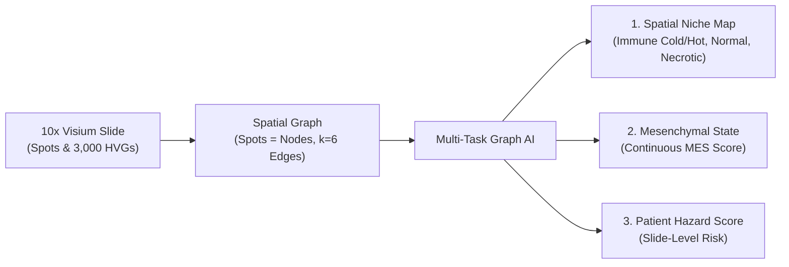

# Chapter 0: Overview & Project Roadmap

## 1. What is Glioblastoma?

**Glioblastoma (GBM)** is the most common and aggressive form of adult primary brain malignancy, representing over 50% of all malignant brain tumors ([Stupp et al., *NEJM* 2005](https://doi.org/10.1056/NEJMoa043330); [Brennan et al., *Cell* 2013](https://doi.org/10.1016/j.cell.2013.09.034)). Despite maximal surgical resection, temozolomide chemotherapy, and radiotherapy, recurrence is nearly universal, with a median overall survival of only 12 to 15 months.

Why is glioblastoma so notoriously difficult to treat?

1. **Extreme Cellular Diversity (Heterogeneity)**: Unlike uniform bacterial infections or simple tumors where all cells look identical, a single glioblastoma tumor is a chaotic mixture of diverse cellular states ([Neftel et al., *Cell* 2019](https://doi.org/10.1016/j.cell.2019.06.024)).
2. **Dynamic Neighborhoods (Microenvironments)**: Inside one tumor, some areas are dense with rapidly dividing cancer cells, other areas are suffocating without oxygen (hypoxia) and dying (necrosis), and some areas are infiltrated by immune cells ([Greenwald et al., *Cell* 2024](https://doi.org/10.1016/j.cell.2024.03.029)).
3. **Immunosuppression**: Glioblastoma cells secrete immunosuppressive factors that deactivate T lymphocytes and polarize myeloid cells to support tumor growth.

---

## 2. The Traditional Way vs. The Modern Way

### The Traditional Pathology Method
In traditional pathology:
1. A neurosurgeon removes a piece of brain tumor.
2. The tissue is sliced into ultra-thin sections, stained with purple and pink dyes (H&E stain), and mounted on a glass slide.
3. A pathologist looks through a microscope and manually circles regions: "This looks like dead tissue, this looks like tumor core, this looks like normal brain."

**Limitations**: Manual inspection is subjective, slow, and only sees the visual shapes of cells—it cannot measure the thousands of active molecular processes happening inside them.

### The Modern Way: Spatial Transcriptomics (10x Visium)
Spatial transcriptomics ([Ståhl et al., *Science* 2016](https://doi.org/10.1126/science.aaf2403)) allows measuring gene expression while preserving exact physical coordinates on the tissue slice.

Each tissue section is captured across ~1,000 to ~4,500 microscopic spots. Every spot has:
- A physical $(X, Y)$ coordinate on the tissue.
- An activity measurement for ~3,000 to 20,000 genes.

---

## 3. What Does DeepGraph-GBM Do?

**DeepGraph-GBM** is an Artificial Intelligence (AI) system that automatically reads these spatial transcriptomics tissue slices and solves three major challenges at the same time:

1. **Classifies Cellular Niches**: Identifies which microenvironment each spot belongs to (`immune_cold`, `immune_hot`, `normal`, or `necrotic`) based on audited rules from the SNUH 2026 atlas ([Shah, Park et al., *Nat Commun* 2026](https://doi.org/10.1038/s41467-026-69716-2)).
2. **Measures Mesenchymal Tumor State**: Predicts whether tumor cells have transformed into an aggressive, therapy-resistant "mesenchymal" state ([Neftel et al., *Cell* 2019](https://doi.org/10.1016/j.cell.2019.06.024)).
3. **Estimates Patient Survival Risk**: Aggregates slide-level spatial patterns into a risk score validated against TCGA clinical records ([Brennan et al., *Cell* 2013](https://doi.org/10.1016/j.cell.2013.09.034)).

---

## 4. Why Use a Graph?

In human tissue, a cell's behavior is heavily influenced by who its neighbors are:
- A cancer cell next to blood vessels acts differently than a cancer cell next to dead tissue.
- An immune cell surrounded by suppressive tumor cells gets deactivated.

By connecting neighboring spots into a **spatial graph** ([Hamilton et al., *NeurIPS* 2017](https://arxiv.org/abs/1706.02216)), our AI does not look at spots in isolation. Instead, every spot "talks" to its physical neighbors, sharing information to make smarter, context-aware predictions.

---

## References & Further Reading
- Stupp, R., et al. (2005). *Radiotherapy plus concomitant and adjuvant temozolomide for glioblastoma.* **NEJM**, 352(10): 987–996. [DOI: 10.1056/NEJMoa043330](https://doi.org/10.1056/NEJMoa043330).
- Ståhl, P. L., et al. (2016). *Visualization and analysis of gene expression in tissue sections by spatial transcriptomics.* **Science**, 353(6294): 78–82. [DOI: 10.1126/science.aaf2403](https://doi.org/10.1126/science.aaf2403).
- Shah, N., Park, S., et al. (2026). *A spatially resolved human glioblastoma atlas reveals distinct cellular and molecular patterns of anatomical niches.* **Nat Commun**, 17. [DOI: 10.1038/s41467-026-69716-2](https://doi.org/10.1038/s41467-026-69716-2).
- See complete bibliography in [**Chapter 7: Scientific Evidence & Citations**](07_references_and_citations.md).

---

## Next Step
Continue to [**Chapter 1: Biology & Data Explained Simply**](01_biology_and_spatial_data.md) to understand the biological niches, genes, and datasets used in this project.
