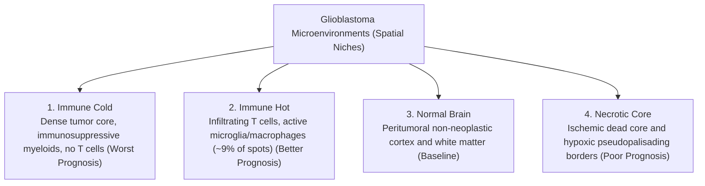

# Chapter 1: Biology & Data Explained Simply

## 1. What are Genes and Gene Expression?

To understand spatial transcriptomics, think of human biology like a kitchen:
- **DNA (The Master Cookbook)**: Present in every cell's nucleus, containing the complete recipes for every protein the body could ever make.
- **RNA (Active Recipes / Orders)**: When a cell needs to perform a task, it copies the relevant recipe from DNA into temporary messenger RNA (mRNA).
- **Gene Expression (Activity Level)**: If a spot has 5,000 copies of an immune gene's mRNA, that gene is "highly expressed" (the recipe is being cooked repeatedly). If it has 0 copies, that gene is silent.

In spatial transcriptomics ([Ståhl et al., *Science* 2016](https://doi.org/10.1126/science.aaf2403)), we count the number of mRNA copies for thousands of genes at every single physical spot on the tissue slice.

---

## 2. The 4 Spatial Niches (Microenvironments)

DeepGraph-GBM classifies every spot into one of four biologically distinct microenvironments defined by the SNUH 2026 Glioblastoma Atlas ([Shah, Park et al., *Nat Commun* 2026](https://doi.org/10.1038/s41467-026-69716-2)):

### The "Exclude" Category
Tissue borders often contain ambiguous mixtures or tearing artifacts. To ensure reliable training, ambiguous spots (~9% of spots) are labeled as `exclude` and masked during training so the AI only learns from clear examples.

---

## 3. Highly Variable Genes (HVG Selection)

A human cell can express over 20,000 genes, but most of them are "housekeeping genes"—routine genes that every cell uses just to stay alive (like *GAPDH*). These contain very little diagnostic information.

### How We Select the Top 3,000 Genes
We use the variance-stabilizing dispersion method from **Seurat v3** ([Stuart et al., *Cell* 2019](https://doi.org/10.1016/j.cell.2019.05.031)) implemented in **Scanpy** ([Wolf et al., *Genome Biol* 2018](https://doi.org/10.1186/s13059-017-1382-0)):
1. We calculate how much each gene's expression varies across different tumor spots compared to its average level.
2. We select the top **3,000 Highly Variable Genes (HVGs)**.
3. Key glioblastoma oncogenes (*EGFR*, *VEGFA*, *CHI3L1*, *CD44*, *SOX2*, *OLIG2*) are retained, while noisy housekeeping genes are removed.

---

## 4. The Datasets Used in DeepGraph-GBM

Our project leverages three distinct patient cohorts:

### 1. The SNUH 2026 Atlas (Primary Dataset)
- **Source**: Seoul National University Hospital ([Shah, Park et al., *Nat Commun* 2026](https://doi.org/10.1038/s41467-026-69716-2)).
- **Accession**: NCBI BioProject [PRJNA1337938](https://www.ncbi.nlm.nih.gov/bioproject/PRJNA1337938) | UCSC Cell Browser: [cells.ucsc.edu/?ds=multiomic-gbm](https://cells.ucsc.edu/?ds=multiomic-gbm).
- **Size**: 23 spatial tissue sections from 13 glioblastoma patients (~35,000 spots).
- **Tissue Types**: Both Formalin-Fixed Paraffin-Embedded (FFPE) and fresh-frozen samples.
- **Role**: Used for training, validation threshold tuning, and held-out test evaluation.

### 2. The Greenwald et al. 2024 Cohort (External Validation)
- **Source**: International glioblastoma spatial study ([Greenwald et al., *Cell* 2024](https://doi.org/10.1016/j.cell.2024.03.029)).
- **Accession**: Zenodo Open Data [12624108](https://zenodo.org/records/12624108).
- **Size**: 13 glioblastoma Visium sections.
- **Role**: Tests whether our trained model works on data from completely different hospitals and lab protocols.

### 3. TCGA-GBM (The Cancer Genome Atlas)
- **Source**: National Cancer Institute GDC portal ([Brennan et al., *Cell* 2013](https://doi.org/10.1016/j.cell.2013.09.034)).
- **Size**: 166 glioblastoma patients with matched gene expression and long-term survival records.
- **Role**: Validates whether slide-level spatial risk scores correlate with overall patient survival.

---

## References & Further Reading
- Stuart, T., et al. (2019). *Comprehensive Integration of Single-Cell Data.* **Cell**, 177(7): 1888–1902. [DOI: 10.1016/j.cell.2019.05.031](https://doi.org/10.1016/j.cell.2019.05.031).
- Greenwald, A. C., et al. (2024). *Integrative spatial analysis reveals a multi-layered organization of glioblastoma.* **Cell**, 187(10): 2485–2501. [DOI: 10.1016/j.cell.2024.03.029](https://doi.org/10.1016/j.cell.2024.03.029).
- See complete bibliography in [**Chapter 7: Scientific Evidence & Citations**](07_references_and_citations.md).

---

## Next Step
Continue to [**Chapter 2: Graph Construction & Patient Splits**](02_graph_construction.md) to see how physical coordinates are turned into connected spatial networks.
