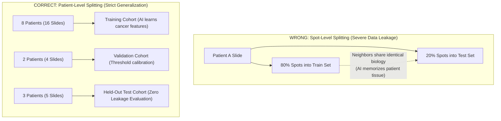

# Chapter 2: Graph Construction & Patient Splits

## 1. Turning a Tissue Slice into a Graph

A 10x Visium glass slide contains a grid of microscopic spots arranged in a **hexagonal honeycomb pattern** (~100 micrometers apart).

In graph terminology:
- **Nodes (Vertices)**: The individual spatial spots. Each node carries a vector of 3,000 numbers (its gene expression counts).
- **Edges (Connections)**: Lines connecting neighboring spots that are physically close to each other.

```
       Hexagonal Grid of Spots                     Connected Spatial Graph
               ( )                                          (O)
              /   \                                        / | \
           ( )     ( )                                  (O)──┼──(O)
            |   *   |          =======>                 / \  |  / \
           ( )     ( )                                (O)──(O)──(O)
              \   /                                        \ | /
               ( )                                          (O)
   (Spots on Visium Slide)                         (k=6 Spatial Graph)
```

---

## 2. How the $k=6$ kNN Graph is Built

Because the Visium grid is hexagonal, every interior spot has exactly **6 immediate neighbors**.

1. For each spot $i$, we calculate the Euclidean distance $d(i, j)$ to all other spots using their 2D physical coordinates.
2. We connect spot $i$ to its 6 nearest neighbors ($k=6$).
3. We make the connections mutual (symmetric).
4. Boundary spots at the edge of the tissue slice naturally have fewer neighbors (average degree is ~5.96 edges per spot).

### Gaussian Distance Edge Weighting
Not all neighbors are equally close (especially around tissue folds or tears). We weight each connection using a Gaussian decay formula:

$$W_{ij} = \exp\left(-\frac{d(i, j)^2}{2 \cdot \text{median}(d)^2}\right)$$

- Immediate adjacent neighbors get a weight close to $1.0$.
- Neighbors separated by a tear or gap get an exponentially lower weight.

---

## 3. Patient-Level Splitting: Preventing "Data Leakage"

One of the most dangerous mistakes in machine learning is **Data Leakage** (when an AI accidentally sees clues from the test set during training).

### The Wrong Way: Random Spot Splitting
If you randomly assign 80% of spots from a slide to the Training Set and 20% to the Test Set:
- Neighboring spots on the same slide share almost identical biology and spatial context.
- The AI will easily memorize the slide rather than learning general cancer biology.
- The model will achieve a fake "99% accuracy" on test spots, but completely fail when given a new patient's tumor.



### Composition of the Standard Split (`configs/splits.json`):
- **Train Set (8 Patients)**: `SNU17`, `SNU18`, `SNU21`, `SNU23`, `SNU25`, `SNU27`, `SNU43`, `SNU46` (16 slides, 23,284 spots).
- **Validation Set (2 Patients)**: `SNU24`, `SNU51` (4 slides, 6,110 spots).
- **Test Set (3 Patients)**: `SNU16`, `SNU33`, `SNU34` (5 slides, 5,594 spots).

---

## 4. Multi-Split Benchmarking (6-Fold Patient Splits)

Because glioblastoma patients differ wildly from one another, testing on just one fixed group of 3 test patients could be lucky or unlucky.

To ensure true scientific rigor, we designed a **6-split benchmark protocol** (`configs/splits_multisplit.json`) where every patient takes turns being in the held-out test set.

---

## Next Step
Continue to [**Chapter 3: Model Architecture & Deep Learning**](03_model_architecture_and_training.md) to explore how Graph Neural Networks process this spatial data.
