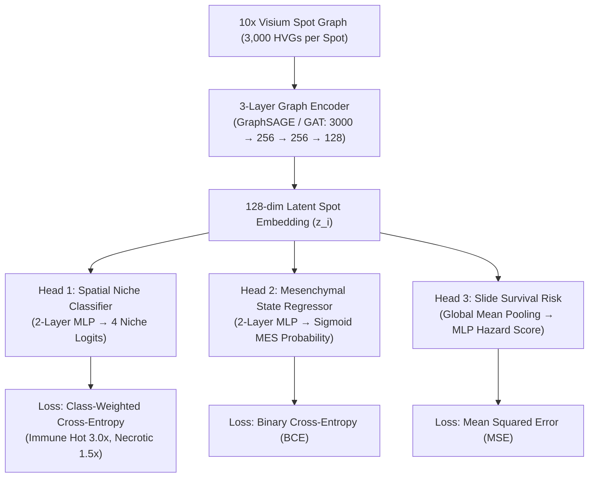

# Chapter 3: Model Architecture & Deep Learning

## 1. What is a Graph Neural Network (GNN)?

In a standard Multi-Layer Perceptron (MLP), each spot's 3,000 gene counts are processed in total isolation:

$$\text{Spot } i \longrightarrow [\text{MLP}] \longrightarrow \text{Prediction for Spot } i$$

A **Graph Neural Network (GNN)** ([Hamilton et al., *NeurIPS* 2017](https://arxiv.org/abs/1706.02216)) works like a team of people having a conversation:
1. **Round 1 (Message Passing)**: Spot $i$ looks at its 6 neighboring spots and calculates an average summary of what its neighbors are doing.
2. **Round 2 (Aggregation & Update)**: Spot $i$ combines its own gene expression with the neighborhood summary to update its internal representation.
3. **Multi-Hop Context**: After 2 or 3 layers of message passing, every spot understands its cellular neighborhood up to ~300 micrometers away!

```
       Step 1: Neighbors Send Messages          Step 2: Spot Updates Representation
            (Neighbor 1)   (Neighbor 2)
                 \             /                       [ Spot i's Own Genes ]
                  \           /                                   +
                   ▼         ▼                         [ Neighbor Summary   ]
                 [ Spot i Node ]                              =======>
                   ▲         ▲                         [ 128-dim Spot Embedding ]
                  /           \
                 /             \
            (Neighbor 3)   (Neighbor 4)
```

---

## 2. GraphSAGE vs. GAT (Graph Attention Network)

DeepGraph-GBM implements two state-of-the-art graph encoder backbones using **PyTorch Geometric** ([Fey & Lenssen, *ICLR-W* 2019](https://arxiv.org/abs/1903.02428)):

### 1. GraphSAGE (Mean Aggregation) ([Hamilton et al., 2017](https://arxiv.org/abs/1706.02216))
- **How it works**: Calculates a uniform weighted average across all 6 neighbors.
- **Parameters**: ~869,000 trainable weights.
- **Strength**: Highly stable, fast, and resistant to overfitting on small patient datasets.

### 2. GAT (Graph Attention Network) ([Veličković et al., *ICLR* 2018](https://arxiv.org/abs/1710.10903))
- **How it works**: Instead of treating all neighbors equally, it uses 4 "attention heads" to ask: *"Which neighbor's genes are most informative right now?"*
- **Parameters**: ~870,000 trainable weights.
- **Strength**: Can focus selectively on specific neighbor interactions (e.g., an immune cell directly touching a tumor cell).

---

## 3. The Multi-Task Brain Architecture

Rather than training 3 separate AI models, DeepGraph-GBM uses a **Multi-Task Learning** architecture with one shared graph encoder and three specialized output heads:



---

## 4. The Multi-Task Loss Function

To train all three heads simultaneously, we combine three loss functions into one master objective:

$$\mathcal{L}_{\text{total}} = 1.0 \cdot \mathcal{L}_{\text{niche}} + 0.5 \cdot \mathcal{L}_{\text{mes}} + 0.5 \cdot \mathcal{L}_{\text{survival}}$$

### How We Handle Class Imbalance
In glioblastoma tissue:
- `immune_cold` represents ~54% of spots.
- `immune_hot` represents only ~9% of spots.

If an AI just guessed `immune_cold` every time, it would get 54% accuracy while being completely useless for finding immune cells!
To fix this, we apply **class weight boosting**:
- `immune_hot` errors are penalized **3.0× harder**.
- `necrotic` errors are penalized **1.5× harder**.

---

## 5. Training Dynamics & Early Stopping

The model is trained using the **AdamW optimizer** with cosine learning rate decay for up to 120 epochs.
To prevent the model from memorizing the training slides, **Early Stopping** monitors performance on the 2 validation patients (`SNU24`, `SNU51`):
- If the validation Macro-F1 score does not improve for 40 consecutive epochs, training automatically stops.
- The model weights from the best validation epoch are saved as `results/models/best_model.pt`.

---

## References & Further Reading
- Hamilton, W. L., Ying, R., & Leskovec, J. (2017). *Inductive Representation Learning on Large Graphs.* **NeurIPS**, 30. [arXiv:1706.02216](https://arxiv.org/abs/1706.02216).
- Veličković, P., et al. (2018). *Graph Attention Networks.* **ICLR**. [arXiv:1710.10903](https://arxiv.org/abs/1710.10903).
- Fey, M., & Lenssen, J. E. (2019). *Fast Graph Representation Learning with PyTorch Geometric.* [arXiv:1903.02428](https://arxiv.org/abs/1903.02428).
- See complete bibliography in [**Chapter 7: Scientific Evidence & Citations**](07_references_and_citations.md).

---

## Next Step
Continue to [**Chapter 4: Model Evaluation & Spatial Inference**](04_evaluation_and_spatial_maps.md) to see how model performance is measured and visualized.
