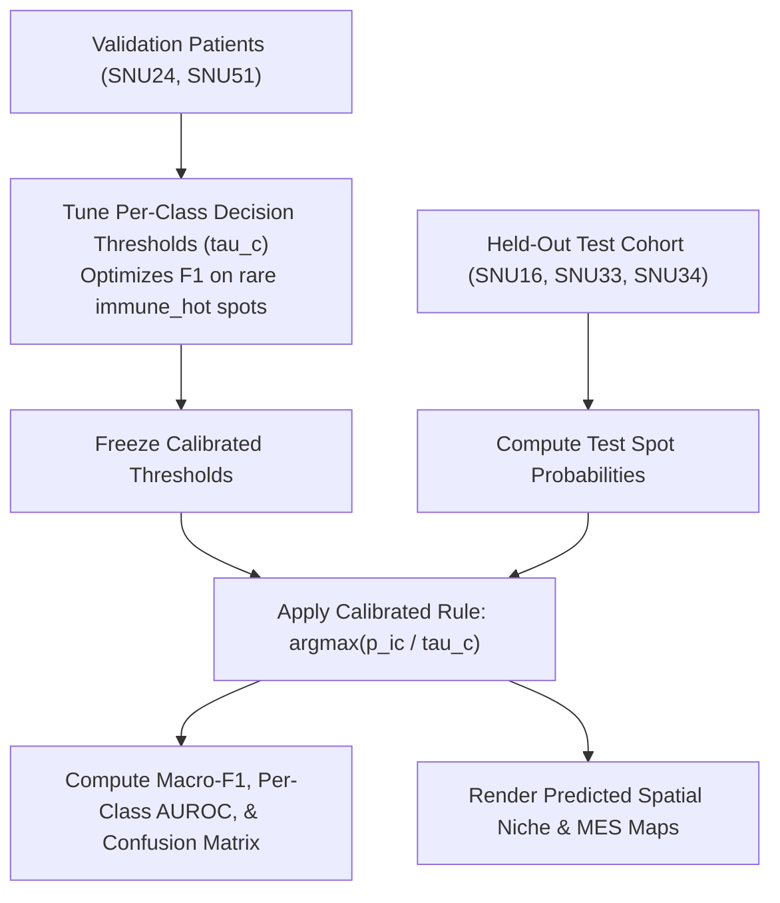
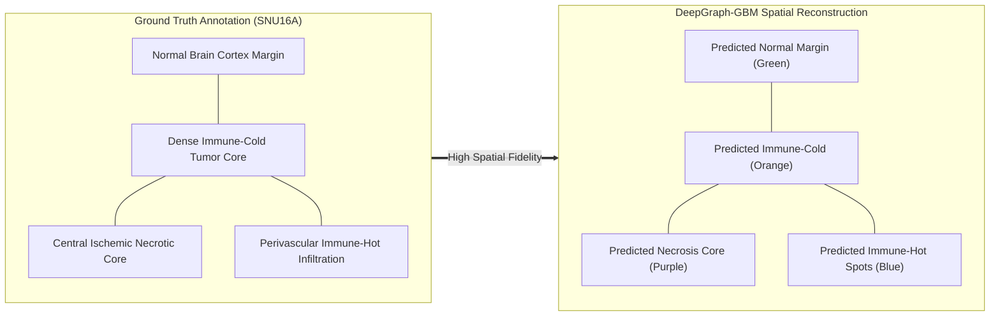

# Chapter 4: Model Evaluation & Spatial Inference

## 1. How Do We Measure AI Performance?

When evaluating medical AI models, simple accuracy (percentage of correct spots) is often misleading because common classes dominate the score. Instead, we use standard scientific metrics:

---

## 2. Validation-Tuned Decision Thresholds ($\tau_c$)

By default, neural networks use the `argmax` rule (whichever class has probability > 0.50 wins).
Because `immune_hot` is rare (~9%), the model rarely outputs a probability above 0.50 for it.

### The Solution: Per-Class Threshold Calibration
We tune a decision threshold $\tau_c$ for each class on the **validation patients**:
- `immune_cold`: $\tau \approx 0.50$ (standard threshold for majority class).
- `immune_hot`: $\tau \approx 0.18$ (lower threshold so subtle immune infiltration is captured).

Then, a spot is classified by:

$$\hat{y}_i = \arg\max_c \left( \frac{p_{ic}}{\tau_c} \right)$$

> **Zero Leakage Rule**: Thresholds are calibrated *strictly* on validation patients (`SNU24`, `SNU51`) and applied *frozen* to the test patients (`SNU16`, `SNU33`, `SNU34`).

---

## 3. Results on Held-Out Test Patients

When evaluated on the 3 held-out test patients (5 slides, 5,594 spots), DeepGraph-GBM achieves:

| Niche Class | F1-Score | AUROC | AUPRC | Biological Interpretation |
|---|---|---|---|---|
| **Immune Cold** | 0.840 | 0.821 | 0.835 | High accuracy on dense tumor parenchyma. |
| **Immune Hot** | 0.286 | 0.976 | 0.407 | Excellent ranking (AUROC 0.98), moderate F1 due to extreme rarity. |
| **Normal Brain** | 0.201 | 0.729 | 0.170 | Identifies non-neoplastic tissue margins. |
| **Necrotic Core** | 0.627 | 0.957 | 0.832 | Clean delineation of dead tissue cores. |
| **Macro-F1** | **0.489** | — | — | Overall multi-class balanced performance. |

---

## 4. Visualizing Spatial Prediction Maps

The ultimate test of a spatial biology AI is whether its predictions recreate the true histological architecture of the tissue section.

For section `SNU16A`:

- **Necrosis (Purple)**: Correctly concentrated in the ischemic tumor core.
- **Immune Hot (Blue)**: Correctly localized to perivascular and infiltrative border zones.
- **Continuous MES Map**: Shows high mesenchymal activity along hypoxic and perinecrotic boundaries, matching established tumor biology.

---

## Next Step
Continue to [**Chapter 5: External Cohorts & Survival Validation**](05_external_validation_and_survival.md) to see how the model generalizes to different hospitals and patient survival records.
