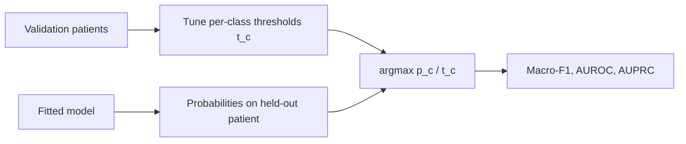
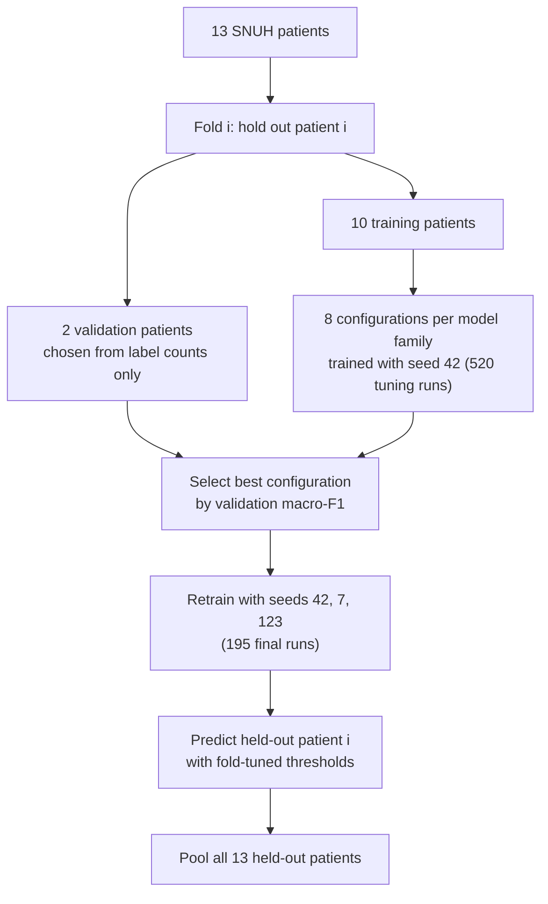

# Chapter 4: The evaluation protocol

A benchmark is only as fair as its protocol. This chapter covers how every model is scored, and
the choices that turned out to move results as much as the architecture did.

## 1. One decision rule for every model

Softmax argmax under-predicts rare classes. Immune-hot is 1.1% of test spots in the primary split.
So for **every** model, a threshold t_c per class is tuned on the validation patients to maximise
one-vs-rest F1, over a grid of 37 values from 0.05 to 0.95. A test spot is then assigned to

$$\hat{y} = \arg\max_c \; p_c / t_c$$

with the validation thresholds applied unchanged. Test labels never touch tuning, early stopping,
configuration selection or marker ranking.

**The decision rule is not neutral.** Scoring the same LOPO fits by plain argmax:
- raises logistic regression (0.704 vs 0.691) and the MLP (0.661 vs 0.655);
- lowers every neighbourhood model: GraphSAGE 0.633 vs 0.652, MLP + neighbours 0.615 vs 0.637,
  GAT 0.614 vs 0.649.

Tuned thresholds help the graph models about twice as much as the graph-free ones. The
logistic–GraphSAGE gap is +0.071 under argmax and +0.039 under the protocol used, so the reported
protocol is the **conservative** choice for the paper's conclusion (Supplementary Table S13).

## 2. Leave-one-patient-out with nested tuning (primary analysis)

Every labelled spot is predicted exactly once, by a model that never saw its patient.

## 3. Metrics

- **Primary metric:** pooled LOPO macro-F1 over all held-out spots, reported as mean ± SD over three
  seeds. Pooling gives every class thousands of spots.
- **Primary contrast:** the difference in pooled macro-F1 against GraphSAGE, with a 95% CI from a
  **patient-level bootstrap** (resample the 13 patients with replacement, 2,000 times).
- **Secondary view:** per-patient macro-F1 (n = 13), compared with paired Wilcoxon signed-rank and
  paired t-tests, Holm-adjusted across the four contrasts.
- **Also reported:** weighted-F1, accuracy, one-vs-rest AUROC and AUPRC per class. For the MES head:
  AUROC, AUPRC and a point-biserial correlation with the binary target.

### The per-patient scoring trap

Per-patient macro-F1 averages F1 over the classes present in that patient, whatever their size.
Several patients carry single-digit counts of a class:
- SNU25 has one immune-hot spot;
- SNU16 has eight;
- SNU34 and SNU46 have none;
- SNU46 is 99.8% normal.

A class measured on a handful of spots is weighted like one measured on thousands. Requiring 50 or
200 labelled spots of a class before it enters a patient's score (Supplementary Table S12) leaves
every contrast's direction unchanged. However, it removes the significance of the MLP-vs-GraphSAGE
per-patient result (p = 0.048 → 0.41), which the paper therefore does not claim.

## 4. The weaker designs, and what each is used for

| Design | Statistics | Used for |
|---|---|---|
| Fixed primary split, 3 seeds | Welch t-tests on per-seed macro-F1, because seeds are not paired across models; one-sample t against the deterministic logistic value | Table 1, Figures 1–3, qualitative maps |
| Six splits × 3 seeds × 4 models (72 runs) | Variance of split means vs mean within-split seed variance | **Variance decomposition only.** Its tuning blocks cannot calibrate immune-hot, so its p-values are descriptive. |
| LOPO (13 folds) | Patient bootstrap and per-patient tests | **Model ranking** |

A seed-paired t-test on the fixed split (p = 0.0017) appeared in an earlier version. It treated
seeds as shared units across models, which they are not, and was replaced by Welch's test
(p = 0.012) in v5.

## 5. Ablations (LOPO folds, default hyperparameters, seed 42)

These ablations are summarised as mean per-patient macro-F1, which is lower than pooled macro-F1:
- **GraphSAGE depth × neighbourhood:** 1–3 layers × k = 6, 12, 18;
- **MLP depth:** 1–3 layers;
- **MLP + neighbours:** hops (1, 2) × k;
- **Marker-gene removal:** drop the 100 or 500 genes with the highest ANOVA F for the niche labels,
  ranked on each fold's *training* spots only, then retrain logistic regression, MLP, MLP +
  neighbours and GraphSAGE.

With one seed and a between-patient SD of about 0.15, these runs can detect only large effects.

---

## Next

[Chapter 5: Benchmark results](05_benchmark_results.md)
