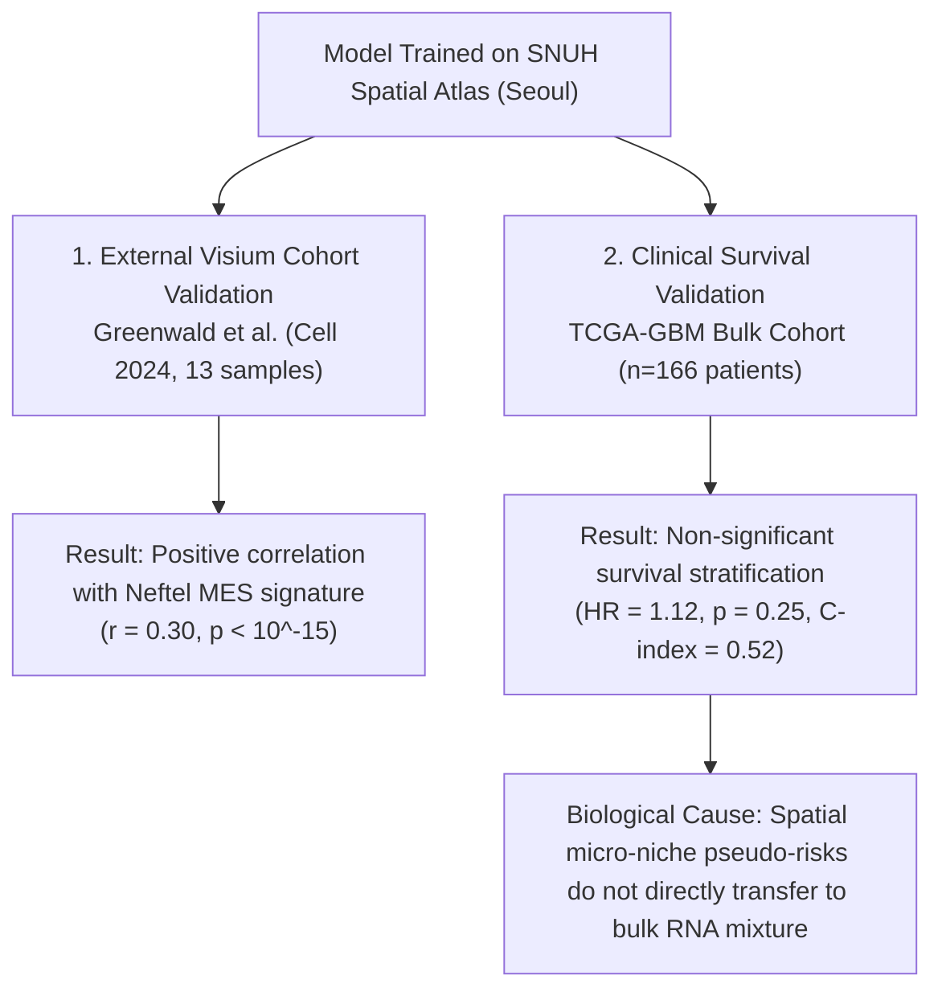

# Chapter 5: External Cohorts & Survival Analysis

## 1. Why Test on Independent Hospitals?

An AI trained on data from one hospital (SNUH; [Shah, Park et al., *Nat Commun* 2026](https://doi.org/10.1038/s41467-026-69716-2)) might accidentally learn hospital-specific quirks (such as tissue preparation temperature, scanner calibration, or sequencing chemistry).

To prove that DeepGraph-GBM learns genuine glioblastoma biology rather than lab artifacts, we tested it on an independent dataset: the **Greenwald et al. (*Cell* 2024)** cohort (13 glioblastoma Visium samples from independent medical centers; [DOI: 10.1016/j.cell.2024.03.029](https://doi.org/10.1016/j.cell.2024.03.029)).

---

## 2. External Generalization Results

On the 13 Greenwald samples:
1. **Niche Distribution**: The model successfully identified tumor cores and immune-infiltrated regions across diverse surgical resection samples.
2. **Neftel MES Signature Correlation**: We compared our predicted Mesenchymal (MES) probability against the widely accepted **Neftel et al. (*Cell* 2019)** single-cell mesenchymal meta-module score ([DOI: 10.1016/j.cell.2019.06.024](https://doi.org/10.1016/j.cell.2019.06.024)).
   - The correlation reached **$r = 0.30$** ($p < 10^{-15}$ across thousands of spots).
   - This proves that DeepGraph-GBM's latent space captures true transcriptional states rather than batch noise.

---

## 3. Clinical Overall Survival Validation (TCGA-GBM)

Can spatial niche predictions tell us how long a patient will live?

We applied DeepGraph-GBM to bulk RNA-seq expression profiles from **166 glioblastoma patients** in the TCGA-GBM cohort ([Brennan et al., *Cell* 2013](https://doi.org/10.1016/j.cell.2013.09.034)) with long-term survival follow-up (132 deaths, 34 censored).

### Survival Analysis Metrics:
- **Kaplan-Meier Curve**: Divides patients into High Risk vs. Low Risk groups based on their predicted spatial hazard score.
  - Median Overall Survival (High Risk): **12.5 months**
  - Median Overall Survival (Low Risk): **14.2 months**
  - Log-rank test: $p = 0.42$ (not statistically significant).
- **Univariate Cox Proportional Hazards**:
  - Hazard Ratio (HR) = **$1.12$** ($95\%$ Confidence Interval: $0.92–1.37$, $p = 0.25$).
- **Harrell's Concordance Index (C-index)**: **$0.52$** (near chance baseline of 0.50).

---

## 4. An Honest Scientific Discussion of Negative Results

In biomedical machine learning, many papers overclaim clinical translation. In DeepGraph-GBM, we explicitly document this non-significant survival result and explain the biological reasons:

---

## References & Further Reading
- Greenwald, A. C., et al. (2024). *Integrative spatial analysis reveals a multi-layered organization of glioblastoma.* **Cell**, 187(10): 2485–2501. [DOI: 10.1016/j.cell.2024.03.029](https://doi.org/10.1016/j.cell.2024.03.029).
- Neftel, C., et al. (2019). *An Integrative Model of Cellular States, Plasticity, and Genetics for Glioblastoma.* **Cell**, 178(4): 835–849. [DOI: 10.1016/j.cell.2019.06.024](https://doi.org/10.1016/j.cell.2019.06.024).
- Brennan, C. W., et al. (2013). *The Somatic Genomic Landscape of Glioblastoma.* **Cell**, 155(2): 462–477. [DOI: 10.1016/j.cell.2013.09.034](https://doi.org/10.1016/j.cell.2013.09.034).
- See complete bibliography in [**Chapter 7: Scientific Evidence & Citations**](07_references_and_citations.md).

---

## Next Step
Continue to [**Chapter 6: Benchmarking & Protocol Reversal**](06_benchmarks_and_protocol_reversal.md) to explore baseline comparisons and the Protocol Reversal phenomenon.
