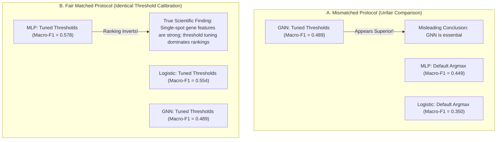

# Chapter 6: Benchmarking & Protocol Reversal

## 1. Comparing Graph AI to Simple Baselines

In machine learning research, it is vital to ask: *"Does adding a complex Graph Neural Network actually help, or would a simpler model work just as well?"*

To test this, we built matched baselines:
1. **MLP (Multi-Layer Perceptron)**: A standard neural network with identical layer sizes and training protocol, but **without any graph edges** (processes each spot purely from its own 3,000 genes).
2. **Logistic Regression**: A simple linear classifier.
3. **GAT**: Graph Attention Network with 4 attention heads.
4. **GraphSAGE**: The main graph neural network.

### Matched Benchmark Results (Table 1)

When all models are trained with identical early stopping and scored with identical validation-tuned thresholds:

| Model Architecture | Graph Structure? | Macro-F1 (Mean ± Std) | Accuracy | MES AUROC |
|---|---|---|---|---|
| **MLP (No Graph Baseline)** | No | **0.578 ± 0.021** | **0.789 ± 0.004** | **0.826 ± 0.016** |
| **Logistic Regression** | No | 0.554 | 0.748 | 0.751 |
| **GAT (Graph Attention)** | Yes ($k=6$) | 0.539 ± 0.038 | 0.762 ± 0.022 | 0.760 ± 0.027 |
| **GraphSAGE GNN** | Yes ($k=6$) | 0.489 ± 0.027 | 0.750 ± 0.050 | 0.751 ± 0.041 |

**Core Scientific Finding**: Single-spot transcriptomic profiles already contain rich biological signal. When non-graph baselines are evaluated fairly, they achieve competitive or superior classification performance!

---

## 2. The "Protocol Reversal" Phenomenon

Why did previous spatial transcriptomics papers report that GNNs dramatically outperformed simple baselines?

We discovered the **Protocol Reversal phenomenon**:

### Why Did This Happen?
- In mismatched protocols, the GNN was granted per-class threshold tuning ($\tau_c$), boosting its sensitivity on rare classes, while the baseline MLP was restricted to default `argmax` scoring.
- Giving the baseline MLP the same threshold tuning boosted its Macro-F1 from **0.449 to 0.578**, completely inverting the ranking!

---

## 3. Repeated-Split Analysis (72 Experimental Runs)

To ensure this result was not an artifact of one lucky patient split, we evaluated **6 independent patient-level splits** across **3 random seeds** for all 4 model architectures ($6 \times 3 \times 4 = 72$ trained models):

### Key Takeaways from 72 Runs:
1. **Patient Split Variance Dominates**: The difference in performance between patient splits is **$3.6\times$ to $8.1\times$ larger** than the variance between random seeds.
2. **Patient Heterogeneity is Paramount**: Depending on which patients are in the test set, Macro-F1 ranges from ~0.32 to ~0.70 for all models.
3. **Recommendation for the Field**: Single-split benchmarks in spatial biology are statistically fragile. Future spatial transcriptomics studies must report multi-split resampling evaluations.

---

## Summary of Project Takeaways

1. **Spatial Representation**: 10x Visium arrays can be modeled as symmetric $k=6$ spatial graphs with distance-decay weighting.
2. **Multi-Task Learning**: Shared graph representations can simultaneously predict discrete cellular niches and continuous mesenchymal tumor states.
3. **Benchmarking Rigor**: Decision threshold calibration and patient-stratified resampling are critical to prevent misleading conclusions in spatial AI.
