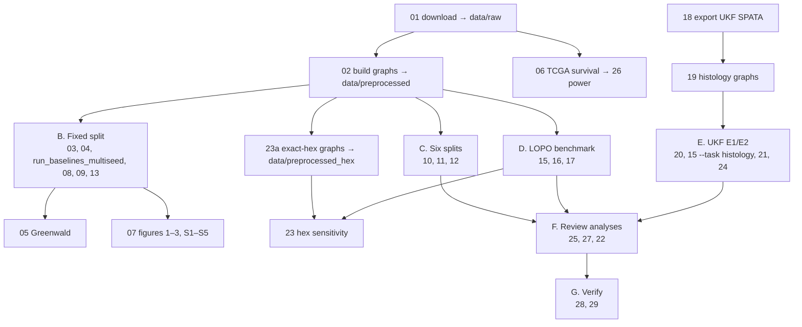

# Reproduction workflow

This guide reproduces every table and figure of manuscript v7.1 (`preprint/spatial-niche-gbm.tex`).
For *what* the analyses mean, read the chapters in this folder. This page covers *how* to run them.

There are two ways to reproduce the results.

| Route | Needs | Time | What it confirms |
|---|---|---|---|
| **Re-derive from records** | this repository only | minutes | Every published number matches the tracked run records |
| **Re-run from raw data** | ~11 GB of public data, a multi-core CPU | days (≈1,400 LOPO/UKF runs) | The run records themselves |

---

## 0. Setup and the fast route

```bash
python -m venv .venv && .venv/bin/pip install -e ".[dev]"   # or: conda env create -f environment.yml
PYTHONPATH=src .venv/bin/pytest -q tests                      # 18 tests, no data needed

# re-derive the published numbers from results/ (no data, no training)
PYTHONPATH=src .venv/bin/python scripts/28_verify_manuscript_numbers.py   # 35/35
PYTHONPATH=src .venv/bin/python scripts/29_code_audit_checks.py           # 99/99
```

Software versions used: Python 3.11, PyTorch 2.7 (2.13 for the multi-split, GAT, LOPO and UKF
runs), PyTorch Geometric 2.8, scanpy 1.11, scikit-learn 1.9, lifelines 0.30, R 4.6 with `Matrix`
(UKF export only). Everything runs on CPU.

---

## Pipeline map



---

## A. Data and graphs

```bash
# A1. Public data: SNUH atlas (UCSC Cell Browser), Greenwald (Zenodo), TCGA-GBM (GDC)
bash scripts/01_download_data.sh data/raw

# A2. SNUH graphs: QC, 3,000 seurat_v3 HVGs, 6-NN graphs, niche + MES labels.
#     Writes data/preprocessed/{graphs.pt, hvg_genes.json, sections_meta.csv, *_coords.npy}.
python scripts/02_build_graphs.py --data-dir data/raw/snuh --out-dir data/preprocessed \
    --config configs/default.yaml --labels configs/labels.yaml --splits-out data/preprocessed/splits_regenerated.json

# A3. Exact-hexagonal graphs for the geometry sensitivity analysis (reproduces the
#     published data/preprocessed_hex bit for bit)
python scripts/23a_build_hex_graphs.py
```

**Do not let step A2 overwrite `configs/splits.json`.** The script regenerates splits with a greedy
balancing rule. The published primary split (train SNU17/18/21/23/25/27/43/46, val SNU24/51,
test SNU16/33/34) is the tracked `configs/splits.json`, so write the regenerated file elsewhere,
as above.

---

## B. Fixed primary split (Table 1, Figures 1–3, Supplementary Figures S1–S5, external cohort)

```bash
# B1. Multi-task GraphSAGE, three seeds (published weights: results/models/)
for s in 42 7 123; do
  python scripts/03_train.py --data data/preprocessed --out results/models/seed$s --seed $s
  python scripts/04_evaluate.py --data data/preprocessed \
      --ckpt results/models/seed$s/best_model.pt --out results/models/eval_seed$s
done
#     The published files are flattened to results/models/seed{s}_metrics.json; script 09
#     reads either layout. Table 1's GAT row is split 0 of the six-split benchmark
#     (results/multisplit/gat_split0_seed*.json, step C), which uses the primary split.

# B2. Matched-protocol baselines (MLP + logistic, 3 seeds, tuned thresholds)
python scripts/run_baselines_multiseed.py --data data/preprocessed \
    --out results/baselines_multiseed_matched

# B3. Table 1, its statistics and Supplementary Table S5
python scripts/08_paired_test.py --gnn results/models --gat results/multisplit \
    --baselines results/baselines_multiseed_matched --out results/tables/main/Table1_paired_test.json
python scripts/09_make_table1.py --gnn results/models \
    --baselines results/baselines_multiseed_matched \
    --paired results/tables/main/Table1_paired_test.json \
    --out-main results/tables/main/Table1_model_comparison.json \
    --out-supp results/tables/supplement/TableS5_per_seed_metrics.csv

# B4. Decision-rule control on the fixed split (section 2.3: argmax vs tuned)
python scripts/13_mlp_argmax_control.py --data data/preprocessed \
    --out results/baselines_multiseed_matched/mlp_argmax_control.json        # MLP 0.557 vs 0.571
python scripts/run_baselines.py --data data/preprocessed \
    --out results/baselines_original_protocol_rerun                          # logistic argmax 0.541

# B5. External cohort (Greenwald): matched CP100k scaling, plus the CP10k sensitivity
python scripts/05_external_validation.py --greenwald-dir data/raw/greenwald \
    --ckpt results/models/best_model.pt --hvg data/preprocessed/hvg_genes.json --out results/external_v2
python scripts/05_external_validation.py --greenwald-dir data/raw/greenwald \
    --ckpt results/models/best_model.pt --hvg data/preprocessed/hvg_genes.json \
    --target-sum 1e4 --out results/external_v2_ts1e4

# B6. Figures 1–3 and Supplementary Figures S1–S5 (argmax maps; qualitative)
python scripts/07_make_figures.py --data data/preprocessed --ckpt results/models/best_model.pt \
    --survival results/tables/supplement/TableS4_tcga_scores_clinical.csv --out results/figures
```

`results/models/best_model.pt` is the seed-7 GraphSAGE model that the manuscript calls
"representative". Its thresholds are 0.30/0.05/0.725/0.15.

---

## C. Six patient splits (variance decomposition only)

```bash
python scripts/10_make_splits.py --data data/preprocessed --out configs/splits_multisplit.json
# one run per (split, seed, model): 6 x 3 x 4 = 72 runs
python scripts/11_run_multisplit.py --data data/preprocessed --split split3 --seed 42 --model gnn \
    --out results/multisplit                       # GAT: --model gnn --encoder gat --tag gat
python scripts/12_aggregate_multisplit.py --runs results/multisplit --out-dir results/multisplit \
    --table results/tables/supplement/TableS6_per_split_metrics.csv \
    --fig results/figures/main/Figure_split_robustness                       # Figure 4
```

---

## D. Leave-one-patient-out benchmark (primary analysis)

```bash
# D1. Folds and the stage-1 job list: 520 tuning runs (8 configurations x 5 families x
#     13 folds, seed 42), 234 ablation runs and 104 marker-removal runs. The worker
#     script expects stage 1 split by phase into jobs_tune.jsonl and jobs_extra.jsonl.
python scripts/15_revision_benchmark.py make-jobs --out results/revision
python - <<'PY'
import json
rows = [json.loads(l) for l in open("results/revision/jobs_stage1.jsonl")]
for name, keep in (("jobs_tune", {"tune"}), ("jobs_extra", {"ablation", "dropgenes"})):
    with open(f"results/revision/{name}.jsonl", "w") as f:
        f.writelines(json.dumps(r) + "\n" for r in rows if r["phase"] in keep)
PY

# D2. Run the queue. Workers share every job list, claim jobs with lock files and skip
#     finished outputs. The worker script runs tuning, then make-final (best config per
#     fold, seeds 42/7/123), then the ablation and marker-removal jobs.
for i in 0 1 2 3 4 5; do nohup bash scripts/run_revision_worker.sh $i >> results/revision/logs/w$i.log 2>&1 & done
#     equivalent manual steps:
#     python scripts/15_revision_benchmark.py run --jobs results/revision/jobs_tune.jsonl
#     python scripts/15_revision_benchmark.py make-final --out results/revision
#     python scripts/15_revision_benchmark.py run --jobs results/revision/jobs_final.jsonl
#     python scripts/15_revision_benchmark.py run --jobs results/revision/jobs_extra.jsonl

# D3. Homophily, then the aggregate tables and figures (Table 2, Figures 5–7)
python scripts/16_label_homophily.py --data data/preprocessed --out results/revision
python scripts/17_revision_analysis.py --rev results/revision --data data/preprocessed \
    --figdir results/figures/revision

# D4. Exact-hex sensitivity: final GraphSAGE/GAT jobs on data/preprocessed_hex
python scripts/15_revision_benchmark.py run --jobs results/revision_hex/jobs_final_hex.jsonl \
    --out results/revision_hex --data data/preprocessed_hex
python scripts/23_hex_sensitivity.py                 # -> results/revision_hex/hex_sensitivity.json
```

---

## E. Neuropathologist-annotated cohort (UKF)

```bash
# E1. Export the SPATA objects (from Dryad / Zenodo) to counts, coordinates and annotations
Rscript scripts/18_export_spata_objects.R <dir_with_RDS> data/raw/ukf_spata

# E2. Graphs: <out>/ukf (within-cohort, CP10k, UKF HVGs) and <out>/transfer (SNUH + UKF,
#     shared genes, SNUH HVGs, UKF at CP100k to match SNUH)
python scripts/19_build_histology_graphs.py --out data/preprocessed_histology

# E3. Job lists, then run them with the same benchmark runner
python scripts/20_make_histology_jobs.py --data data/preprocessed_histology
python scripts/15_revision_benchmark.py run --task histology --jobs results/revision_ukf/jobs.jsonl \
    --out results/revision_ukf --data data/preprocessed_histology/ukf
python scripts/15_revision_benchmark.py run --task histology --jobs results/revision_transfer_v2/jobs.jsonl \
    --out results/revision_transfer_v2 --data data/preprocessed_histology/transfer

# E4. Analysis (Figure 8, Figure 9, Supplementary Figure S6) and the released annotations (Table S9)
python scripts/21_histology_analysis.py --figdir results/figures/revision
python scripts/24_export_ukf_annotations.py data/raw/ukf_spata \
    results/tables/supplement/TableS9_ukf_pathologist_annotations.csv
```

The published E2 runs read a directory named `transfer_v2`. It holds the same data that step E2
now writes to `transfer`: the earlier CP10k build rescaled exactly by log1p(10·expm1(x)), identical
to float precision. `results/revision_transfer` holds the earlier CP10k transfer runs, which the
manuscript reports only as a scaling sensitivity analysis.

---

## F. Survival, review analyses and composite figures

```bash
python scripts/06_survival_validation.py --tcga-dir data/raw/tcga --out results/survival
cp results/survival/tcga_scores_clinical.csv results/tables/supplement/TableS4_tcga_scores_clinical.csv
python scripts/26_survival_power.py        # per-SD HRs, age control, detectable effect -> Table 3
python scripts/25_review_sensitivity.py    # Tables S10–S13, slide_risk_head_eval.csv
python scripts/27_fig_robustness.py        # Supplementary Figure S7 -> preprint/figures
python scripts/22_graphical_abstract.py    # graphical abstract -> preprint/figures
```

Figure 10 (Kaplan–Meier) is drawn by step B6 from `TableS4_tcga_scores_clinical.csv`.

## G. Verify and build the manuscript

```bash
PYTHONPATH=src python scripts/28_verify_manuscript_numbers.py
PYTHONPATH=src python scripts/29_code_audit_checks.py
cd preprint && tectonic spatial-niche-gbm.tex     # or: pdflatex, bibtex, pdflatex, pdflatex
```

Published figures live in `preprint/figures/`. Steps B6, C, D3 and E4 write intermediate renders to
`results/figures/` (not tracked). Copy a render into `preprint/figures/` to update the manuscript.

---

## Manuscript figure and table map

| Manuscript | File(s) in `preprint/figures/` | Produced by |
|---|---|---|
| Graphical abstract | `graphical_abstract.png` | 22 |
| Figure 1 (UMAP) | `Figure1_umap_niche.png` | 07 |
| Figure 2 (ROC) | `Figure2_roc_curves.png` | 07 |
| Figure 3 (confusion, argmax) | `Figure3_confusion_matrix.png` | 07 |
| Figure 4 (six splits) | `Figure_split_robustness.png` | 12 |
| Figure 5 (LOPO) | `FigR1_lopo_comparison.png`, `FigR4_confusion_pooled.png` | 17 |
| Figure 6 (ablation, marker removal) | `FigR2_ablation.png`, `FigR3_marker_removal.png` | 17 |
| Figure 7 (LOPO maps) | `maps_lopo_SNU16A.png`, `maps_lopo_SNU34A.png` | 17 |
| Figure 8 (pathologist labels) | `FigR5_pathologist_labels.png` | 21 |
| Figure 9 (UKF map) | `maps_path_UKF251_T.png` | 21 |
| Figure 10 (Kaplan–Meier) | `Figure5_km_survival.png` | 07 |
| Figures S1–S5 (fixed-split maps) | `Figure4{a,b,c}_SNU16A_*`, `FigureS{1..4}{a,b,c}_*` | 07 |
| Figure S6 (UKF maps) | `maps_path_UKF{243,260,269}_T.png` | 21 |
| Figure S7 (robustness) | `FigS7_robustness.png` | 27 |

File names predate the final numbering. The table above is the mapping. Scripts 17 and 21 name
their map renders `maps_<section>.png` and `maps_path_<section>.png`. The LOPO maps were renamed
`maps_lopo_<section>.png` when they were copied into `preprint/figures/`.

| Table | File in `results/tables/` | Produced by |
|---|---|---|
| Table 1 | `main/Table1_model_comparison.json`, `main/Table1_paired_test.json` (GAT row: `results/multisplit/gat_split0_*`) | 08, 09, 11 |
| Table 2 | `results/revision/revision_summary.json` | 17 |
| Table 3 | `main/Table3_survival_results.json` | 06, 26 |
| S1, S3 | `supplement/TableS1_greenwald_summary.json`, `TableS3_greenwald_predictions.csv` | 05 |
| S2 | `supplement/TableS2_sections_meta.csv` | 02 |
| S4 | `supplement/TableS4_tcga_scores_clinical.csv` | 06 |
| S5 | `supplement/TableS5_per_seed_metrics.csv` | 09 |
| S6 | `supplement/TableS6_per_split_metrics.csv` | 12 |
| S7 | `main/Table2_test_metrics.json` (seed-7 val/test metrics) | 04 |
| S8 | `results/multisplit/multisplit_summary.json` | 12 |
| S9 | `supplement/TableS9_ukf_pathologist_annotations.csv` | 24 |
| S10–S13 | `supplement/TableS10…S13_*.csv` | 25 |

---

## Result-file conventions (read before recomputing anything)

1. **`results/multisplit/*.json` does not name the architecture in `model`.** GraphSAGE and GAT
   are both stored as `"model": "gnn"` and differ only in the `"encoder"` field (`"gat"`, or absent
   for GraphSAGE). Grouping by `model` silently averages the two. See `multisplit_scores` in
   `scripts/25_review_sensitivity.py`.
2. **Prediction arrays in `results/revision/preds/` include unlabelled spots** with `y = -1`. Mask
   with `y >= 0` before scoring, as `pooled` in `scripts/17_revision_analysis.py` does. Without the
   mask, macro-F1 drops by about 0.1. These `.npz` arrays are not tracked (~90 MB). Every scalar
   they produce is already in `runs/*.json` and the tables.
3. **Two fixed-split training runs exist.**
   - `results/models/` holds the published models behind Table 1 and Figures 1–3.
   - `results/rerun_20261009/` is a later retrain with current software versions. It supplies the
     refit logistic value quoted in section 2.3 (0.557) and the slide-level head evaluation
     (`scripts/25`).

## What is archived, and why

| Path | Content | Why it is kept |
|---|---|---|
| `scripts/archive/14_fig_protocol_reversal.py` | Figure for the retracted protocol-reversal claim | Provenance for `preprint/ANALYSIS_AUDIT.md` finding 1 |
| `results/archive/baselines_multiseed_unmatched/` | Early multi-seed baselines (MLP not under the matched protocol) | Superseded by `baselines_multiseed_matched/` |
| `results/archive/tables/` | Original-protocol baselines (incl. the superseded-feature version) and pre-audit CP10k Greenwald tables | Provenance only; nothing in v7.1 reads them |
| `preprint/archive/` | Manuscript snapshots v1–v7, their bibliographies, and the pre-pivot manuscript and graphical abstract | Version history (see `preprint/revision_notes.md`) |

Nothing in `archive/` is used by any current script, table or figure.
