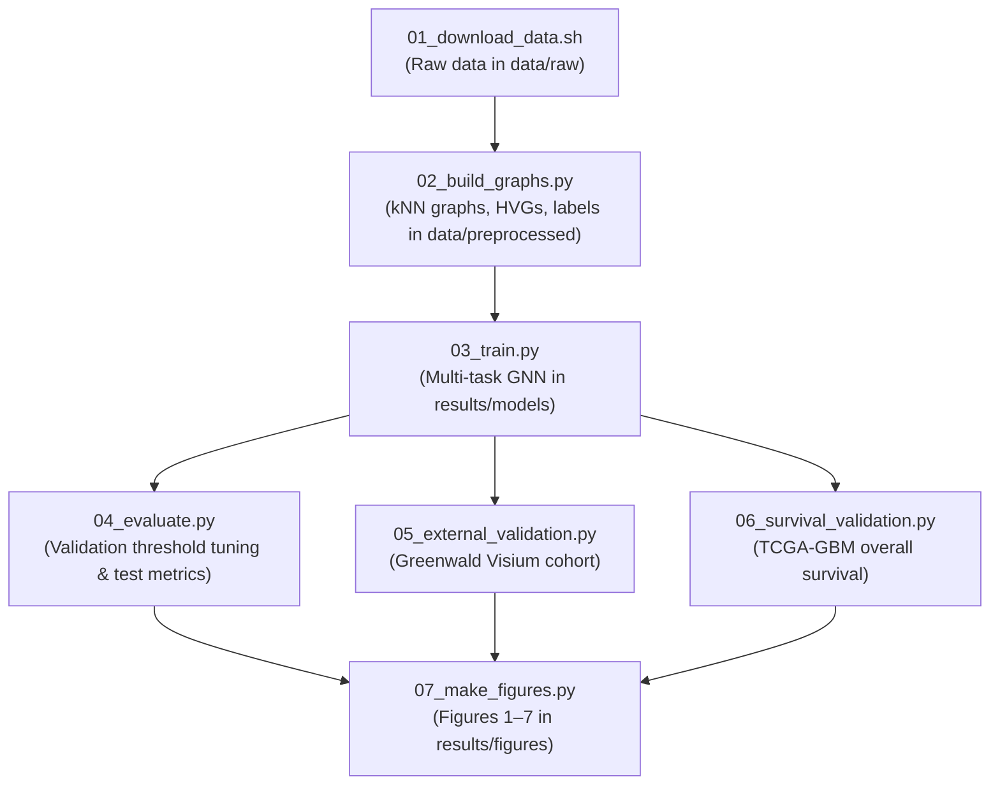

# DeepGraph-GBM — Local Reproduction Guide

This bundle contains everything needed to reproduce the DeepGraph-GBM results **offline**:
the complete source code, all raw data, the preprocessed graphs, the trained model, and every
generated figure and table. No download is required unless you want to re-fetch the data from
the original sources.

```
deepgraph-gbm/
├── .github/                  # CI workflows
│   └── workflows/ci.yml
├── configs/                  # default.yaml, labels.yaml, splits.json, splits_multisplit.json
├── data/
│   ├── raw/                  # original downloaded data (snuh, greenwald, tcga)
│   └── preprocessed/         # graphs.pt, hvg_genes.json, sections_meta.csv, coords, labels
├── manuscript/               # manuscript source (tex, md, pdf, references.bib, figures)
├── notebooks/                # 03_demo_inference.ipynb
├── results/
│   ├── figures/              # Figures 1–7 (main) + Figure S1–S4 (supplement)
│   ├── tables/               # Table 1–3 (main) + Table S1–S7 (supplement)
│   ├── models/               # best_model.pt + per-seed metrics + history
│   ├── baselines_multiseed_matched/  # matched-protocol baseline runs (Table 1)
│   ├── baselines_multiseed/          # earlier multi-seed run (superseded; kept for provenance)
│   └── multisplit/           # 72 repeated-split run JSONs + multisplit_summary.json
├── scripts/                  # numbered pipeline 01 → 14 + baseline runners
├── src/deepgraph_gbm/        # data / models / training / interpret modules
├── tests/                    # pytest suite (18 tests)
├── README.md                 # project overview & science
├── README_REPRODUCE.md       # this file
└── pyproject.toml / requirements.txt / environment.yml
```

---

## 1. Environment setup

Python 3.10–3.11, CPU-only (a GPU is optional and not required).

**Option A — conda (recommended, matches development):**
```bash
conda env create -f environment.yml
conda activate deepgraph-gbm
pip install -e .
```

**Option B — pip / venv:**
```bash
python -m venv .venv && source .venv/bin/activate
pip install -r requirements.txt
pip install -e .
```

`pip install -e .` installs the `deepgraph_gbm` package from `src` so the scripts can
import it. Versions used to produce these results: PyTorch 2.7 (2.13 for the repeated-split
and GAT benchmark), torch_geometric 2.8, scanpy 1.11, lifelines 0.30, umap-learn,
scikit-misc (needed for the `seurat_v3` HVG flavor).

**Sanity check — run the test suite (18 tests, ~30 s):**
```bash
python -m pytest tests -q
```

---

## 2. Quick start — run inference with the trained model (no retraining)

Everything is already computed. To load the bundled model and reproduce predictions on the
held-out test patients:

```bash
python scripts/04_evaluate.py \
    --config configs/default.yaml \
    --data data/preprocessed \
    --ckpt results/models/best_model.pt \
    --out /tmp/eval_out
```
This writes `test_metrics.json` and a per-spot `test_predictions.csv`. Compare against the
bundled `results/tables/`.

Or open the interactive demo (loads graphs + model, runs inference, draws spatial maps):
```bash
jupyter notebook notebooks/03_demo_inference.ipynb
```
Edit the paths in the first cell to point at `data/preprocessed` and
`results/models/best_model.pt`.

---

## 3. Full pipeline from raw data (end-to-end reproduction)



Run from the root directory:

```bash
# (optional) re-download raw data from the original sources instead of using data/raw:
#   bash scripts/01_download_data.sh data/raw

# Step 2 — build per-section kNN graphs + niche/MES labels + patient splits + HVGs
#           (reads data/raw/snuh, writes data/preprocessed). ~20–40 min, ~8 GB RAM.
python scripts/02_build_graphs.py \
    --data-dir data/raw/snuh \
    --out-dir data/preprocessed \
    --config configs/default.yaml \
    --labels configs/labels.yaml \
    --splits-out configs/splits.json

# Step 3 — train the multi-task GNN (uses configs/splits.json). ~30–60 min CPU.
python scripts/03_train.py \
    --config configs/default.yaml \
    --data data/preprocessed \
    --out results/models --seed 7

# Step 4 — evaluate on held-out test patients
python scripts/04_evaluate.py \
    --config configs/default.yaml \
    --data data/preprocessed \
    --ckpt results/models/seed7/best_model.pt \
    --out results/tables

# Step 5 — external validation on the Greenwald cohort
python scripts/05_external_validation.py \
    --config configs/default.yaml \
    --greenwald-dir data/raw/greenwald \
    --ckpt results/models/seed7/best_model.pt \
    --hvg data/preprocessed/hvg_genes.json \
    --out results/tables

# Step 6 — TCGA-GBM survival validation (Cox PH + Kaplan–Meier)
python scripts/06_survival_validation.py \
    --tcga-dir data/raw/tcga \
    --out results/tables

# Step 7 — render all figures (niche maps, MES maps, UMAP, ROC, confusion, KM)
python scripts/07_make_figures.py \
    --config configs/default.yaml \
    --data data/preprocessed \
    --ckpt results/models/seed7/best_model.pt \
    --survival results/tables/tcga_scores_clinical.csv \
    --out results/figures
```

> **Note on Step 2 and splits.** `02_build_graphs.py` regenerates `configs/splits.json` with a
> greedy spot-balancing algorithm. The bundled `configs/splits.json` (and the bundled
> `data/preprocessed/graphs.pt`) were produced with a specific stratified split
> (train = SNU17/18/21/23/25/27/43/46, val = SNU24/51, test = SNU16/33/34). To reproduce the
> published numbers exactly, **use the bundled `data/preprocessed/` and `configs/splits.json`
> as-is** and skip re-running Step 2, or restore the bundled `splits.json` before Step 3.

---

## 4. Benchmark reproduction (matched protocol, repeated splits, GAT)

The benchmark results in Table 1, Figures 4–5, and Tables S6–S7 come from the benchmark
scripts below. All `--data` arguments point at the directory containing `graphs.pt`
(`data/preprocessed` in the bundle).

```bash
# Step 8 — matched-protocol multi-seed baselines (MLP + logistic, seeds 42/7/123,
#          tuned thresholds; ~1–2 h CPU). Writes results/baselines_multiseed_matched/.
python scripts/run_baselines_multiseed.py \
    --config configs/default.yaml \
    --data data/preprocessed \
    --out results/baselines_multiseed_matched

# Step 9 — paired tests (GNN vs baselines) and Table 1 / Table S6
python scripts/08_paired_test.py \
    --gnn results/models \
    --baselines results/baselines_multiseed_matched \
    --out results/tables/main/Table1_paired_test.json

python scripts/09_make_table1.py \
    --gnn results/models \
    --baselines results/baselines_multiseed_matched \
    --paired results/tables/main/Table1_paired_test.json \
    --out-main results/tables/main/Table1_model_comparison.json \
    --out-supp results/tables/supplement/TableS5_per_seed_metrics.csv

# Step 10 — generate the six patient-level splits (split 0 = the original split;
#           generator seeds 1001–1005; writes configs/splits_multisplit.json)
python scripts/10_make_splits.py \
    --config configs/default.yaml \
    --data data/preprocessed \
    --out configs/splits_multisplit.json

# Step 11 — repeated-split benchmark: one run per (split × seed × model).
#           6 splits × 3 seeds × 4 models = 72 trained models in total
#           (GNN/GAT ~10–20 min per run on CPU; MLP/logistic faster).
#           Example: GraphSAGE on split 3, seed 42 —
python scripts/11_run_multisplit.py \
    --config configs/default.yaml \
    --data data/preprocessed \
    --splits configs/splits_multisplit.json \
    --split split3 --seed 42 --model gnn \
    --out results/multisplit
#           GAT arm: add --encoder gat --tag gat (output files are gat_split*_seed*.json).
#           Baselines: --model mlp or --model logistic.

# Step 12 — aggregate the 72 runs: multisplit_summary.json + Table S7 + Figure 5
python scripts/12_aggregate_multisplit.py \
    --runs results/multisplit \
    --out-dir results/multisplit \
    --table results/tables/supplement/TableS6_per_split_metrics.csv \
    --fig results/figures/main/Figure_split_robustness

# Step 13 — scoring-rule control: matched-protocol MLP scored by argmax vs tuned
#           thresholds (writes mlp_argmax_control.json)
python scripts/13_mlp_argmax_control.py \
    --config configs/default.yaml \
    --data data/preprocessed \
    --out results/baselines_multiseed_matched/mlp_argmax_control.json

# Step 14 — protocol-reversal figure (manuscript Figure 4)
python scripts/14_fig_protocol_reversal.py \
    --table-s1 results/tables/archive/baseline_original_protocol_metrics.json \
    --table1 results/tables/main/Table1_model_comparison.json \
    --control results/baselines_multiseed_matched/mlp_argmax_control.json \
    --out results/figures/main/Figure_protocol_reversal
```

> **Note on `results/baselines_multiseed/`.** This directory holds an earlier multi-seed
> baseline run (tuned thresholds, but the MLP trained under the original non-matched
> optimization protocol). It is superseded by `baselines_multiseed_matched/` for all
> published numbers and is retained only for provenance.

---

## 5. What each result file is

All figures are **publication-quality**: no embedded titles (titles belong in captions), 300 dpi PNG +
editable-text SVG, Liberation Sans, and an Okabe-Ito colorblind-safe palette.

**`results/figures/main/`** — the core story. File names predate the final manuscript
numbering; the mapping is:

| File | Manuscript figure | Content |
|---|---|---|
| `Figure1_umap_niche` | Figure 1 | UMAP of test-spot embeddings colored by niche |
| `Figure2_roc_curves` | Figure 2 | one-vs-rest ROC for the 4 niche classes (with AUCs) |
| `Figure3_confusion_matrix` | Figure 3 | row-normalized confusion matrix |
| `Figure_protocol_reversal` | Figure 4 | identical scoring reverses the model ranking (3 panels) |
| `Figure_split_robustness` | Figure 5 | per-split macro-F1 for 4 models + paired differences vs GraphSAGE |
| `Figure4a/b/c` | Figure 6 | representative test section SNU16A: true niche map, predicted niche map, MES probability map |
| `Figure5_km_survival` | Figure 7 | TCGA Kaplan–Meier curves, high vs low predicted risk (log-rank p annotated in-plot) |

**`results/figures/supplement/`** — remaining test sections (SNU16B, SNU33A, SNU33B, SNU34A)
| Figure | Content |
|---|---|
| `FigureS1–S4` (a/b/c per section) | true niche map, predicted niche map, MES probability map |

**`results/tables/main/`**
| Table | Content |
|---|---|
| `Table1_model_comparison.json` | GNN vs GAT vs MLP vs logistic regression (3 seeds, fixed split) |
| `Table1_paired_test.json` | paired t-test / Wilcoxon on per-seed macro-F1 |
| `Table2_test_metrics.json` | full val + test metrics for the trained model (seed 7) |
| `Table3_survival_results.json` | TCGA Cox HR, C-index, KM log-rank for the risk score |

**`results/tables/supplement/`**
| Table | Content |
|---|---|
| `archive/baseline_original_protocol_metrics.json` | original argmax-scored baseline metrics (protocol-reversal panel A) |
| `TableS1_greenwald_summary.json` | per-sample external-validation summary (13 samples) |
| `TableS2_sections_meta.csv` | per-section spot counts, split assignment, pseudo-risk |
| `TableS3_greenwald_predictions.csv` | per-spot external predictions + Neftel MES reference |
| `TableS4_tcga_scores_clinical.csv` | per-patient TCGA niche scores + survival covariates |
| `TableS5_per_seed_metrics.csv` | per-seed matched-protocol metrics, all models, fixed split |
| `TableS6_per_split_metrics.csv` | per-split, per-seed metrics for all 4 models × 6 splits (72 runs) |

**`results/models/`**
| File | Content |
|---|---|
| `best_model.pt` | trained multi-task GNN weights (seed 7, ~7 MB) |
| `seed42/7/123_metrics.json` | per-seed val + test metrics for the GNN (fixed split) |
| `seed7_history.csv` | per-epoch training/validation loss history |

**`results/multisplit/`** — the repeated-split benchmark
| File | Content |
|---|---|
| `{gnn,mlp,logistic,gat}_split{0–5}_seed{42,7,123}.json` | 72 per-run result files (metrics, thresholds, confusion) |
| `multisplit_summary.json` | split means, paired tests on split means, variance decomposition |

---

## 6. Headline results (for reference when you re-run)

**Held-out test patients (SNU16, SNU33, SNU34), fixed split, 3 seeds, matched protocol:**
- GNN (GraphSAGE): macro-F1 **0.489 ± 0.027**, accuracy 0.750 ± 0.050
- GAT encoder: macro-F1 0.539 ± 0.063
- MLP (no graph): macro-F1 **0.578 ± 0.021** — significantly above the GNN (paired p = 0.0017)
- Logistic regression: macro-F1 0.554 (vs GNN p = 0.053)
- Representative GNN (seed 7): per-class AUROC immune_cold **0.82**, immune_hot **0.98**,
  normal **0.73**, necrotic **0.96**; MES probability AUROC **0.75**, Pearson r **0.34**

**Repeated-split benchmark (6 patient-level splits × 3 seeds × 4 models = 72 runs):**
- Logistic regression outperforms the GraphSAGE GNN on **all six splits** (split-mean
  macro-F1 0.572 ± 0.090 vs 0.487 ± 0.109; paired p = 0.0004).
- GAT significantly improves over GraphSAGE on all six splits (+0.037, p = 0.007) but ties
  the MLP (p = 0.89) and remains below logistic regression (p = 0.034).
- Patient-split identity dominates: split means span 0.32–0.70 for every model, and
  across-split variance is 3.6–8.1× the within-split seed variance.

**Protocol-reversal control (manuscript Figure 4).** Under the original mismatched scoring
(GNN tuned thresholds, baselines argmax) the GNN appeared best (0.489 vs 0.449 MLP, 0.350
logistic). Scoring all models identically inverts the ranking. The deterministic logistic
model gains +0.20 macro-F1 from tuned thresholds alone (0.350 → 0.554); the matched MLP gains
only +0.014 (0.557 → 0.571). Scoring rules, not graph structure, created the apparent GNN
advantage.

**External validation (Greenwald Cell 2024, 13 samples):** predicted niche compositions
transfer at the level of global composition but do **not** track the annotated sampling
region, and MES probability correlates only variably with the Neftel MES meta-module
(mean r = 0.30, range −0.34 to 0.65).

**TCGA survival validation — an honest negative result.** The niche-composition risk score
does **not** significantly stratify TCGA-GBM overall survival. On the expression-matched cohort
(n = 166; 132 deaths, 34 censored): univariate Cox HR = 1.12 (95% CI 0.92–1.37, p = 0.25),
C-index = 0.52, KM log-rank p = 0.42 (median OS 424 vs 444 days, high vs low risk). Treat the
survival head as **discovery-level / non-significant** — it is trained on a niche-composition
pseudo-risk (no Visium cohort has matched survival), and this TCGA analysis is the validation,
which is negative.

---

## 7. Known limitations (read before extending)

- **Silver-standard labels.** Niche labels are derived from the SNUH atlas's own anatomical-feature
  and metaprogram annotations by the rules in `code/configs/labels.yaml` — not pathologist ground truth.
- **Class imbalance / over-prediction of immune_cold.** immune_hot is ~9% of spots; the model
  over-predicts immune_cold on test (see `confusion_matrix.png`). Per-class thresholds are tuned on
  the validation patients and applied to test (`tune_thresholds` in `training/evaluate.py`).
- **HVG selection matters.** HVGs are selected with scanpy's `seurat_v3` flavor on
  `expm1`-reconstructed counts (the SNUH matrix is log1p-normalized). An earlier raw-dispersion
  approach selected only housekeeping genes and destroyed external-cohort performance — do not revert
  this in `02_build_graphs.py`.
- **Survival head** is validated, not trained, on real outcomes, and the validation is non-significant
  (above).
- **Finite split resampling.** The repeated-split benchmark uses six splits drawn from 13 patients;
  training sets overlap across splits (not fully independent), and at n = 6 the Wilcoxon test cannot
  resolve below p = 0.031. The MLP-vs-GNN comparison is direction-consistent (5/6 splits) but not
  significant at this sample size (p = 0.137).
- **TCGA censoring.** Overall-survival times combine `days_to_death` (events) with
  `days_to_last_follow_up` (censored), the latter read from the GDC `diagnoses` record. The
  expression-matched cohort (n = 166) includes 34 censored patients; right-censoring is handled by the
  Cox/KM estimators in `training/survival.py`. Median follow-up is short (~9 months for censored
  patients), which limits power to detect a survival association.

---

## 8. Sequential Exploration Notebooks

The `notebooks/` directory contains an interactive, sequential exploration series:

| Notebook | Topic / Content |
|---|---|
| `01_data_exploration.ipynb` | SNUH atlas inspection, spot metadata, Seurat-v3 HVG genes, niche label rules |
| `02_spatial_graphs_and_splits.ipynb` | Spatial kNN graph construction ($k=6$), PyG `Data` structures, patient-level splits |
| `03_model_architecture_and_training.ipynb` | Multi-task GNN (GraphSAGE/GAT) architecture, loss formulation, training curves |
| `04_model_evaluation_and_inference.ipynb` | Pre-trained model evaluation, validation threshold tuning, spatial niche & MES maps |
| `05_external_and_survival_validation.ipynb` | Greenwald Visium cohort generalization, TCGA-GBM Kaplan–Meier & Cox survival analysis |
| `06_benchmarking_and_protocol_reversal.ipynb` | Matched baseline comparison, Protocol Reversal analysis, 72-run multi-split variance |

All core result figures and tables can also be generated directly via the numbered `scripts/` pipeline.

---

## Data sources (please cite)

- **SNUH 2026 GBM atlas** — Park HJ, Sonpatki P, Schroeder BA, et al., *Nat Commun* 17(1):2951 (2026), PRJNA1337938, via UCSC Cell Browser (`cells.ucsc.edu/?ds=multiomic-gbm`).
- **Greenwald et al.** — *Cell* 187(10):2485–2501 (2024), Zenodo record 12624108 (CC-BY).
- **TCGA-GBM** — NCI Genomic Data Commons.
- **Neftel et al.** — *Cell* 178(4):835–849 (2019) (MES meta-module reference).

License: MIT (see `code/LICENSE`).
